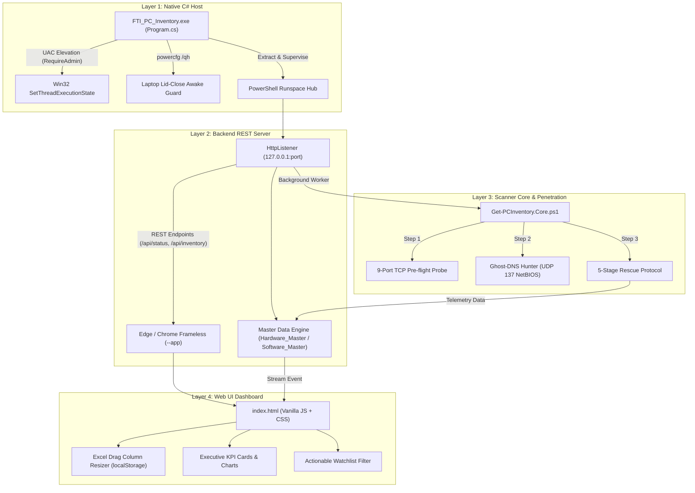

# สถาปัตยกรรม 4 เลเยอร์ของ FTI PC Inventory Tool (v2026.11 Enterprise)

เอกสารอธิบายโครงสร้างเชิงลึก (Deep-Dive Architectural Guide) ของระบบสำรวจและวิเคราะห์ฮาร์ดแวร์-ซอฟต์แวร์เครื่องคอมพิวเตอร์ในองค์กร (**FTI PC Inventory Tool**)

> 💡 มีหน้าเอกสารแบบ Interactive Web Explorer ที่เปิดดูได้ในบราวเซอร์: [`FTI_PC_Inventory_Architecture_Guide.html`](./FTI_PC_Inventory_Architecture_Guide.html)

---

## 1. ภาพรวมสถาปัตยกรรมทั้งระบบ (Overall Architecture)

ระบบถูกออกแบบด้วยแนวคิด **Decoupled 4-Tier Architecture** เพื่อความเสถียร ความเร็ว และอัตราการเจาะข้อมูลสำเร็จสูงสุดในเครือข่ายองค์กร:



---

## 2. เจาะลึกรายเลเยอร์ (Layer-by-Layer Breakdown)

### Layer 1: Native C# Host & Power Management Engine
- **ไฟล์ต้นทาง:** `src/host/Program.cs`, `app.manifest`
- **คอมไพเลอร์:** C# (.NET Framework 4.8 / 4.7.2) ผ่าน `csc.exe`
- **หน้าที่หลัก:**
  1. **UAC Elevation:** บังคับขอสิทธิ์ `requireAdministrator` ตั้งแต่วินาทีแรก เพื่อให้สามารถสร้าง Raw UDP Socket สำหรับ NetBIOS และเข้าถึงการตั้งค่า Windows Power ได้
  2. **Win32 Power State Guard:** เรียก Native Win32 API `SetThreadExecutionState(ES_CONTINUOUS | ES_SYSTEM_REQUIRED | ES_AWAYMODE_REQUIRED)` ป้องกันไม่ให้ CPU หรือ Network Adapter เข้าสู่โหมด Sleep แม้หน้าจอดับหรือล็อกเครื่อง
  3. **Laptop Lid-Close Guard:** สอบถามค่า `powercfg /qh` ปัจจุบัน (ทั้งโหมด AC และ DC) เก็บแบ็กอัปไว้ที่ `%LOCALAPPDATA%\FTI_PC_Inventory_Tool\lid_state.json` แล้วปรับให้เป็น `0 (Do Nothing)` เพื่อให้พับจอโน้ตบุ๊กแล้วปล่อยให้สแกนข้ามคืนได้
  4. **Process Supervisor:** ดักจับ Event ปิดโปรแกรม เพื่อกู้คืนสถานะ Power Management และหยุด Child Process ทั้งหมดอย่างสะอาด

---

### Layer 2: Backend REST Server & Master Data Hub
- **ไฟล์ต้นทาง:** `src/AppServer.ps1`
- **เทคโนโลยี:** `System.Net.HttpListener`, Isolated PowerShell Runspace
- **หน้าที่หลัก:**
  1. **Lightweight Web Server:** ให้บริการ REST API บน Localhost พร้อมระบบจัดการ CORS และเปิดหน้าต่าง Edge/Chrome ในโหมด `--app=http://127.0.0.1:port` ไร้แถบ Address Bar
  2. **Multi-threaded Runspace:** แยกการประมวลผลงานสแกนเครือข่ายออกจาก UI Server ด้วย `[powershell]::Create()` ทำให้หน้าบ้านไม่ค้างแม้สแกนเครื่องจำนวนมาก
  3. **Master Data Sync Engine:** ซิงก์ข้อมูลอ่านและเขียนอัตโนมัติกับโฟลเดอร์ `Inventory_Tool_data`:
     - `Hardware_Master.csv` (สเปกเครื่อง, ซีเรียล, เมนบอร์ด, แรม, การ์ดจอ)
     - `Software_Master.csv` (ซอฟต์แวร์ทั้งหมดที่ติดตั้งในแต่ละเครื่อง)

#### REST Endpoints Specification
| Method | Endpoint | หน้าที่ | Response |
| :--- | :--- | :--- | :--- |
| `GET` | `/api/status` | ตรวจสอบสถานะการสแกนและเปอร์เซ็นต์ความคืบหน้า | JSON Status |
| `GET` | `/api/inventory` | ดึงข้อมูลฮาร์ดแวร์ของเครื่องทั้งหมด | JSON Array |
| `POST` | `/api/scan/start` | รับเป้าหมาย (IP/Subnet) แล้วเริ่มสแกน Background | `{ status: "started" }` |
| `POST` | `/api/scan/stop` | หยุดการทำงานของสแกนเนอร์ทันที | `{ status: "stopped" }` |
| `GET` | `/api/export` | ส่งออกผลการสแกนเป็นไฟล์ Excel/CSV | File Download |

---

### Layer 3: Scanner Core & 2-Pass Penetration Engine
- **ไฟล์ต้นทาง:** `src/Get-PCInventory.Core.ps1`
- **หน้าที่หลัก:** หัวใจสำคัญในการเจาะทะลุระบบเครือข่ายองค์กรเพื่อเก็บข้อมูลอย่างแม่นยำ
  1. **9-Port TCP Pre-flight Probe:** ยิงตรวจสอบพอร์ตสำคัญ 9 พอร์ตแบบขนาน (`135, 445, 5985, 5986, 3389, 139, 80, 443, 5900`) ใช้เวลาเฉลี่ย 150ms เพื่อจำแนกประเภทอุปกรณ์ก่อน
  2. **Ghost-DNS Hunter:** ส่งคำสั่งสอบถาม NetBIOS Name ผ่านพอร์ต UDP 137 เมื่อพบว่า DNS ชี้ไปที่ IP ที่ไม่ตรงกับ Hostname จริง พร้อมสั่งรีเฟรช `ipconfig /registerdns` ข้ามเครื่อง
  3. **5-Stage Rescue Protocol (Failover อัตโนมัติ):**
     - **Stage 1 (WinRM):** เร็วที่สุดและปลอดภัยสูงผ่านพอร์ต 5985 (WS-Man)
     - **Stage 2 (Direct IP DCOM):** เจาะตรงผ่าน DCOM/RPC ด้วย NTLM Credential
     - **Stage 3 (PSRemoting):** เปิด PowerShell Session ตรง
     - **Stage 4 (Remote Registry):** ดึงค่าจาก Registry พอร์ต 445 SMB
     - **Stage 5 (Active Directory FQDN):** สลับค้นหาชื่อเต็มบน Domain Controller

---

### Layer 4: Executive Web Dashboard & Interactive Grid
- **ไฟล์ต้นทาง:** `src/web/index.html`
- **เทคโนโลยี:** HTML5, Modern CSS, Vanilla JavaScript (Zero External Heavy Frameworks)
- **หน้าที่หลัก:**
  1. **Excel-Grade Drag Column Resizer:** ลากปรับขนาดความกว้างคอลัมน์ได้อย่างอิสระ หรือดับเบิลคลิกเพื่อ Auto-fit โดยค่าจะถูกจดจำไว้ใน `localStorage`
  2. **Executive KPI Cards & Charts:** แสดงสถิติภาพรวม เช่น สัดส่วนเครื่อง Online/Offline, ชนิด CPU (Intel vs AMD), และเวอร์ชัน Windows
  3. **Actionable Watchlist Filter:** ตัวกรองเครื่องที่ผิดปกติหรือมีความเสี่ยง (สแกนไม่ผ่าน, สเปกต่ำกว่าเกณฑ์)
  4. **A4 Print Stylesheet:** จัดหน้าสำหรับสั่งพิมพ์รายงานลงกระดาษ A4 สไตล์ผู้บริหารทันที

---

## 3. ที่ตั้งไฟล์และข้อมูล (Data Path Architecture)

ทุกผลลัพธ์และฐานข้อมูล Master CSV ถูกกำหนดให้บันทึกรวมศูนย์อยู่ที่:
```
c:\Users\ax_admin.FUNCTION59\Desktop\FTI_INTERN_PROGRAMS\Inventory_Tool_data\
```
- `Hardware_Master.csv`
- `Software_Master.csv`
- `Hardware_Inventory_*.html`
- `Scan_Log_*.txt`
